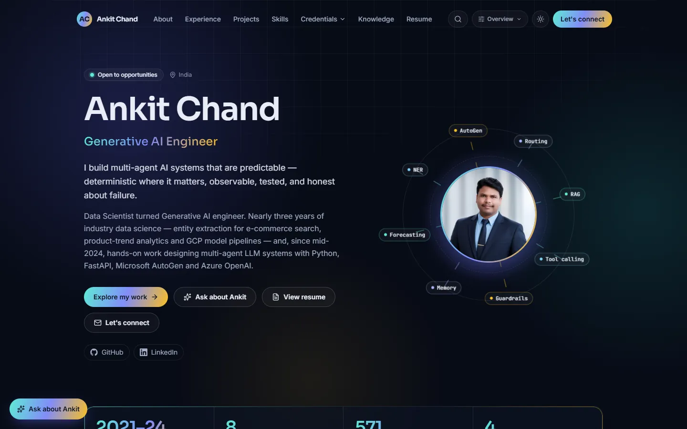
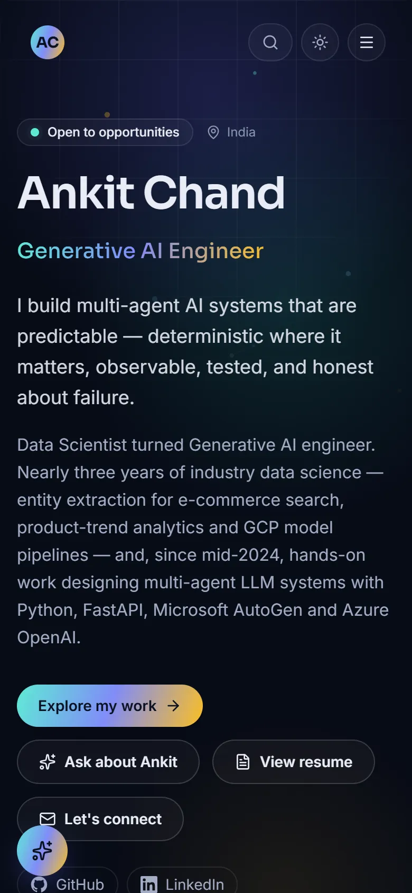
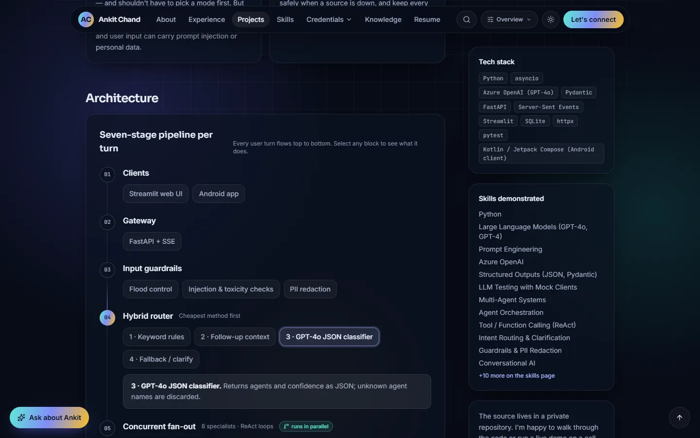
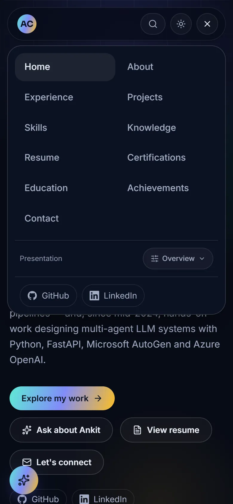

# Ankit Chand — Portfolio

**Live:** https://ankit-chand-portfolio.vercel.app · **Ask about Ankit:** [/ask](https://ankit-chand-portfolio.vercel.app/ask) · **Resume:** [PDF](https://ankit-chand-portfolio.vercel.app/resume/Ankit_Chand_Resume.pdf) · **Assistant docs:** [docs/ASSISTANT.md](docs/ASSISTANT.md) · **QA report:** [docs/QA_REPORT.md](docs/QA_REPORT.md)

Personal portfolio of **Ankit Chand**, Data Scientist and Generative AI & Agentic AI Engineer.
A fast, accessible, content-driven site built with **Next.js 16 (App Router), TypeScript, Tailwind CSS v4 and Motion**, with a secure serverless contact API and **“Ask about Ankit”** — a multi-agent RAG assistant that runs entirely on open-source models with **no paid AI API** ([architecture, models, benchmarks](docs/ASSISTANT.md)).

| Desktop | Phone |
|---|---|
|  |  |
|  |  |

Lighthouse (production, desktop): **Accessibility 100 · Best practices 100 · SEO 100**; performance 98 on the home page and 80–91 on the heaviest case-study page on a throttled test laptop. Fresh-profile browser QA: **28/28 scenarios clean** on production. More screenshots in [docs/screenshots](docs/screenshots).

## Features

| Area | What it does |
|---|---|
| **Ask about Ankit** | Multi-agent assistant (orchestrator, profile, technical, projects, recruitment, navigation and validation agents) over a hybrid BM25 + embedding index of this site's content. Instant verified answers on every device; optional on-device open-weight model (WebLLM) or a self-hosted model. Cited sources, project/certification cards, navigation, follow-ups, 9 visitor personas, full-page mode, session history |
| **Visitor modes** | Overview, Recruiter, Technical, Student, Project explorer and AI conversation views of the same content (`?mode=recruiter` links) |
| **Home** | Animated hero (portrait as the "orchestrator" with orbiting agent capabilities), highlights, expertise, featured projects, dashboard-style quick navigation |
| **Projects** | Searchable, filterable catalogue (category, type, free text) with shareable URLs (`/projects?category=Agentic%20AI`) |
| **Case studies** | Problem, objective, **interactive architecture diagram**, agents & tools, approach, features, challenges (accordions), testing, screenshot gallery with lightbox |
| **Experience** | Expandable timeline with responsibilities, technologies and linked projects |
| **Skills** | Technology explorer — every skill links to the projects that used it (no invented percentages) |
| **Certifications** | Filterable gallery with detail dialogs; supports certificate images/PDFs and verification links |
| **Education · Achievements** | Academic record, coursework, filterable milestone timeline |
| **Knowledge** | Markdown engineering notes with topic filters and a learning map |
| **Resume** | Inline PDF preview, download, and a printable web version the PDF is generated from |
| **Contact** | Validated form → serverless API with honeypot, time-trap, rate limit, origin check; email via Resend and/or webhook; mailto fallback |
| **Site-wide** | Ctrl/⌘ K command palette search, dark/light theme, page transitions, back-to-top, mobile menu, reduced-motion support |
| **SEO** | Per-page metadata, Open Graph images (generated), JSON-LD (Person, SoftwareSourceCode, TechArticle), sitemap.xml, robots.txt, manifest |
| **Profile photo** | Placeholder when no photo is set; password-protected Photo Studio (`/admin/photo`, disabled unless configured) with upload, validation, crop, previews, optional self-hosted enhancement and approve-then-publish |
| **Security** | CSP and hardened headers, no secrets in the client, server-only delivery credentials, deterministic AI guardrails and answer validation, content privacy scan |

## Quick start

```bash
npm install
cp .env.example .env.local     # optional: only needed for contact-form delivery
npm run dev                    # http://localhost:3000
```

Requires Node.js ≥ 20.9 (≥ 22 for the `tools/` workspace). The assistant needs no environment variables.

| Script | Purpose |
|---|---|
| `npm run dev` | Development server |
| `npm run build` / `npm start` | Production build / serve |
| `npm run typecheck` | TypeScript check |
| `npm run validate:content` | JSON + asset checks, privacy/secret scan of `/content` |
| `npm test` | Contact API tests against a running server (`BASE_URL`, default `http://localhost:3000`) |
| `npm run resume:pdf` | Regenerate `public/resume/Ankit_Chand_Resume.pdf` from `/resume/print` (server must be running; `RESUME_URL` to print from production) |
| `npm run qa` | Fresh-profile browser QA (console/network errors, overflow) + screenshots into `docs/screenshots/` (`BASE_URL` to test production) |
| `cd tools && npm run kb:embed` | Rebuild the assistant's embeddings after editing `/content` (a test fails if they are stale) |
| `cd tools && npm test` / `npm run eval` | Assistant tests (guardrails, validator, evaluation set, model contract) / retrieval evaluation |
| `cd tools && npm run bench` | Open-weight model benchmark with llama.cpp ([results](docs/benchmarks/README.md)) |

## Updating content (no code changes)

All content lives in **`/content`** and is validated with zod at build time — a typo fails the build with a clear message instead of shipping a broken page.

| To… | Edit |
|---|---|
| Change name, headline, intro, email, social links, highlights, About text | `content/profile.json` |
| Add or update a job | `content/experience.json` (dates as `YYYY-MM`; `"end": null` = current) |
| Add a project | `content/projects.json` — copy an existing entry; `architecture` (optional) powers the interactive diagram; images go in `public/images/projects/` |
| Add a skill | `content/skills.json` — list project slugs under `evidence` |
| Add a certification | `content/certifications.json` — put the image/PDF in `public/certificates/` and set `file`; add `verifyUrl` if there is one |
| Add education / milestones | `content/education.json`, `content/milestones.json` |
| Write a note | add `content/articles/<slug>.md` with frontmatter (`title`, `summary`, `date`, `topics`, `relatedProjects`) |
| Replace the resume | overwrite `public/resume/Ankit_Chand_Resume.pdf` (or run `npm run resume:pdf`), and update `resume.updated` in `profile.json`. To host it elsewhere, set `resume.file` to a full URL. |

After editing content, run `cd tools && npm run kb:embed` so the assistant's embeddings match. Commit and push — the hosting platform rebuilds and redeploys automatically. There is deliberately **no public editing interface**; content changes go through Git, which gives history, review and rollback for free.

## Contact form delivery

Configure **either or both** in the hosting provider's environment variables (never in code):

| Variable | Purpose |
|---|---|
| `RESEND_API_KEY`, `CONTACT_TO_EMAIL`, `CONTACT_FROM_EMAIL` | Send each message as an email via [Resend](https://resend.com) |
| `CONTACT_WEBHOOK_URL` | POST each message as JSON to Slack / Discord / Make / Zapier |
| `NEXT_PUBLIC_SITE_URL` | Canonical site URL (optional on Vercel) |

Without a delivery channel the API answers `503 not_configured` and the form offers a pre-filled email draft, so no message is lost.

**Protections:** zod validation (client and server), 10 KB body limit, JSON-only, same-origin check, hidden honeypot field (bots get a silent fake success), minimum fill time, link-count limit, per-IP rate limit (5 per 10 minutes, per server instance), HTML-escaped email bodies, `Cache-Control: no-store`.

## Optional: assistant model server and Photo Studio

Neither is needed. See [.env.example](.env.example) and [docs/ASSISTANT.md](docs/ASSISTANT.md#7-setup-and-operations).

| Variable | Purpose |
|---|---|
| `INFERENCE_BASE_URL`, `INFERENCE_API_KEY`, `INFERENCE_MODEL`, `INFERENCE_MODEL_LABEL` | A **self-hosted** open-source model server (llama.cpp, Ollama, vLLM, TGI) behind the site's hardened proxy. Never a paid API. |
| `ADMIN_PASSWORD` (or `ADMIN_PASSWORD_SHA256`), `ADMIN_SESSION_SECRET` | Enable the owner-only Photo Studio at `/admin/photo` |
| `PHOTO_ENHANCER_URL` | Optional self-hosted image-enhancement service (e.g. rembg / Real-ESRGAN) |
| `GITHUB_TOKEN`, `GITHUB_REPO` | Optional: let the studio commit an approved photo (fine-grained token, this repo, Contents write only) |

## Deployment (Vercel)

```bash
npx vercel login
npx vercel deploy --prod
```

This repository is connected to the Vercel project: every push to `main` deploys to production automatically, and pull requests get preview deployments. Add the environment variables above, then redeploy. HTTPS is automatic; custom domains are added under Project → Settings → Domains.

## Project structure

```
content/              ← all portfolio content (JSON + Markdown)
public/images/        ← portrait and project screenshots
public/resume/        ← downloadable resume PDF
public/kb/            ← assistant embeddings (generated by tools/)
public/workers/       ← browser workers for embeddings and WebLLM (plain JS)
src/app/              ← routes (App Router), API routes, sitemap, robots, OG images
src/components/       ← UI components (client components are marked "use client")
src/lib/              ← content loading & schemas, search index, contact logic
src/lib/assistant/    ← assistant pipeline: KB, retrieval, router, agents, validator, orchestrator
scripts/              ← resume PDF generator, content validator, browser QA, WebGPU benchmark
tests/                ← API tests: contact, admin, model proxy (node:test)
tools/                ← offline: embedding build, assistant tests, model benchmarks (not deployed)
docs/                 ← QA report, assistant architecture, benchmarks, screenshots
```

## Privacy

Only professional information is published. The assistant answers only from `/content`, refuses requests for unpublished personal details, keeps conversations in the visitor's tab (`sessionStorage`) and sends nothing to any AI provider. The public resume omits the phone number; screenshots come from public notebooks and contain no personal data; `validate:content` scans content for phone numbers, API keys and local paths before you commit.
